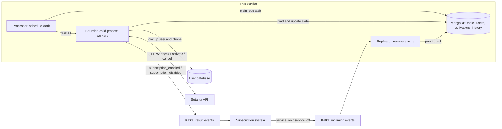
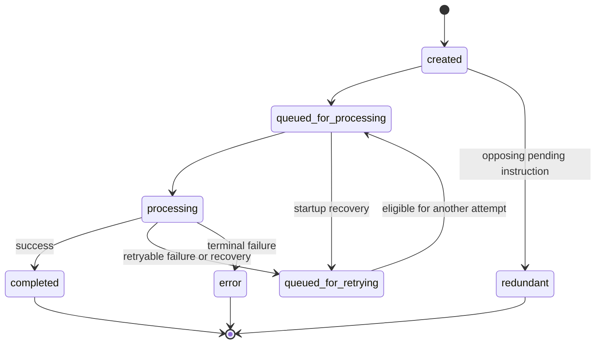

# Streaming platform subscription

I designed and developed an event-driven backend service that lets users purchase Setanta subscriptions from inside the PSP app. It connects subscription lifecycle to Setanta's API and handles activation, cancellation, delayed processing, retries, and recovery after a processor restart.

The service went live in **December 2024**. It has activated subscriptions for **178,000 users** and currently processes approximately **15,000 subscriptions per month**.

> This repository is a sanitized snapshot of my work. Some code and configuration have been changed for sharing, and the current production implementation differs. The walkthrough below describes the implementation visible here. Runtime access to production is not included.

## The problem and business impact

PSP wanted users to access more services without leaving its app. Adding streaming subscriptions generated income from each subscription purchased.

| Result | Meaning |
| --- | --- |
| Launched in December 2024 | The integration shipped to real users. |
| 178,000 users activated | Cumulative reach of the production integration. |
| Approximately 15,000 subscriptions per month | Current monthly subscription processing volume. |
| An additional service inside PSP app | Supports the product's retention goal and earns income on subscription purchases. |

The service's boundary is **subscription fulfillment**. It receives activation and cancellation requests, synchronizes the subscription with Setanta and emits completion events. Payment collection, pricing, the mobile UI and billing decisions belong to upstream systems.

The usage figures describe business adoption; they are not a throughput benchmark. The engineering challenge was coordinating state across the subscription system, local storage, and an external provider when requests fail or processing is interrupted.

## My contribution

I designed the service and implemented it from scratch, including:

- Separating Kafka event ingestion from asynchronous subscription processing.
- Modeling tasks, subscription activations, user mappings, and their state transitions.
- Building the MongoDB-backed task queue, worker integration, delayed retries, conflict resolution, and startup recovery.
- Implementing Setanta account checks, activation, cancellation, response mapping, and authenticated HTTPS communication.
- Connecting the workflow through Kafka and adding request/response logs and state history.

The implementation uses NestJS and the company's shared libraries for infrastructure concerns such as configuration, logging, HTTP communication and Kafka integration. Those shared libraries are dependencies of this project.

## Architecture and request flow

**Stack:** Node.js, TypeScript, NestJS, Kafka, MongoDB/Mongoose, Tinypool, and Pino.



There are two application entry points: the **replicator**, which consumes Kafka events and persists tasks, and the **processor**, which schedules those tasks. The processor delegates execution to a bounded pool of child processes. This separates accepting work from the speed and availability of the external provider.

An activation follows this path:

1. The replicator receives a user ID and subscription ID, then creates an `On` task in MongoDB.
2. After its processing delay, the processor claims the task and passes its ID to a worker.
3. The activation use case obtains the user's phone number and resolves or creates the local Setanta user mapping.
4. If a local active activation already exists, the use case returns its ID. Otherwise, it creates an activation record and checks Setanta's current state.
5. If Setanta already reports an active subscription, the service records that state locally. Otherwise, it requests activation, passing the subscription ID as `purchaseId`.
6. After reconciling or creating the provider subscription, the use case records the activation details and invokes publication of a `subscription_enabled` event containing the activation URL. The task processor then marks the task completed.

Cancellation uses the same task pipeline. It checks the provider's state first: if the subscription is already inactive, it records the cancellation locally; otherwise, it calls Setanta's cancellation endpoint. It then invokes the disabled event and completes the task.

## Technical decisions and challenges

### 1. Keeping external API work separate from event ingestion

Calling Setanta inside the Kafka consumer would tie event handling to provider latency. Persisting a task gives the integration a separate processing lifecycle: it can defer work, retain error details, and attempt recovery without keeping the original consumer handler occupied.

Kafka carries requests and results between services. MongoDB stores the work this service still needs to perform, alongside activation state and history. A database-backed queue makes due times, attempts, and processing status directly inspectable. The cost is maintaining queue behavior ourselves, including locking, recovery, scheduling queries, and indexes.

The task repository claims one eligible document using a MongoDB `findOneAndUpdate` operation. The **claim operation** is atomic. It does not make the entire subscription workflow atomic or guarantee exclusive processing for its full duration.

In [TaskRepositoryImpl.getNext](src/infrastructure/data/impl/mongo/repositories/task.ts), eligibility and locking are part of the same database operation:

```typescript
async getNext(states: TaskState[]): Promise<Task | null> {
    const currentDate = new Date();

    const query = {
        state: { $in: states },
        locked: false,
        processTime: { $lt: currentDate },
    };

    const update = {
        locked: true,
        lockedAt: currentDate,
    };

    const options = {
        sort: {
            createdAt: SortValues.ASC,
        },
    };

    return await super.getOneAndUpdate(query, update, options);
}
```

The [base repository](src/infrastructure/data/impl/mongo/mongoose-repository.ts) delegates to Mongoose's `findOneAndUpdate` and returns the updated document. Eligible tasks are selected oldest first. The [task schema](src/infrastructure/data/impl/mongo/schemas/task.ts) does not declare a supporting compound index; before increasing volume, I would measure this filter and sort with `explain()` on representative data and compare index choices against their write cost.

### 2. Handling uncertain outcomes from Setanta

An external request can succeed even when the caller does not receive its response. Retrying the write immediately could repeat an operation that already happened.

The activation flow checks local state and then the provider before requesting a new activation. When Setanta reports an existing active subscription, the service adopts that state and stores the returned identifiers and activation URL.

This branch in the [activation use case](src/app/useCases/processor/subscriptionActivate/subscriptionActivate.ts) runs before the call that creates a provider subscription:

```typescript
const setantaCheckResponse: CheckResponse =
    await this.setantaService.checkSubscription({ setantaUserId });

if (setantaCheckResponse.userHasActiveActivation) {
    await this.setantaActivationsService.changeState(
        activation, ActivationState.Active, setantaCheckResponse.data
    );

    this.sendSubscriptionEnabledEvent(params, {
        setantaActivationUrl: setantaCheckResponse.data.setantaAccountActivationUrl
    });

    return {
        success: true,
        activationId,
    };
}
```

Cancellation similarly checks whether the desired inactive state already exists before making another write. These checks reduce repeated provider operations during sequential retries.

For example, if Setanta activates a subscription but the response is lost, a later attempt can discover the active subscription and reconcile local state. This is not an exactly-once guarantee: concurrent attempts can both observe an inactive subscription, and local state changes and Kafka publication are separate operations.

### 3. Making processing state explicit and recoverable

Tasks track their instruction, scheduled time, attempt count, activation ID, errors, and completion time. Their allowed transitions are defined in [task-state.ts](src/domain/task/task-state.ts):



Missing users or phone numbers produce terminal activation errors. Other failures are generally returned as retryable. The processor persists the outcome, and retry scheduling advances `processTime` by a configured interval. On startup, the recovery service moves queued or processing tasks back to the retry state.

The [activation error handler](src/app/useCases/processor/subscriptionActivate/subscriptionActivate.ts) makes that decision explicit:

```typescript
private handleError(e, activationId: string | null): SubscriptionActivateUseCaseResponse {
    if (
        e instanceof UserNotFoundError ||
        e instanceof UserPhoneNotFoundError
    ) {
        return this.returnErrorResponse({
            activationId, shouldRetry: false, message: this.getErrorMessage(e)
        });
    }

    return this.returnErrorResponse({
        activationId, shouldRetry: true,
        message: this.getErrorMessage(e), errorData: this.getDefaultError(e)
    });
}
```

The shared [result types](src/app/useCases/processor/common/types.ts) distinguish `success: true` from `success: false`; failed results include `shouldRetry` and error details. This lets the use case classify the outcome while the task processor owns persistence and scheduling. The snapshot has no retry limit or exponential backoff. Because the retry interval is added to the previous scheduled time, an overdue task can become eligible again immediately.

Tasks and activations have separate state machines: an execution attempt and a customer's entitlement describe different things. The shared `Stateful` decorator validates allowed transitions and records their history, helping explain how an entity reached its current state. These history writes are separate database operations.

### 4. Avoiding unnecessary opposing operations

A user can generate activation and cancellation requests close together. The initial processing delay gives the service a window to inspect pending work before contacting Setanta.

The [conflict resolver](src/infrastructure/conflicting-tasks-resolver/service/conflicting-tasks-resolver.ts) groups eligible `Created` tasks by user. When it finds an `On`/`Off` pair, it marks both redundant and stores their cross-references. This avoids making two opposing provider calls for a pending pair.

This encodes a business assumption: those pending instructions cancel each other out. The implementation matches by user, rather than subscription, and does not provide general event ordering or handle already-running tasks. For a broader product model, I would make subscription identity and event ordering explicit.

### 5. Bounding concurrency and isolating the provider integration

The processor checks worker capacity before dequeuing more work and adjusts its polling delay when the queue is empty or full. Tinypool is configured with the `child_process` runtime, a process limit and a bounded in-memory queue. Persistent tasks remain the source of pending work.

The bounds are explicit in the [worker pool](src/infrastructure/worker-pool/impl/tiny-worker-pool.ts):

```typescript
this.pool = new Tinypool({
    runtime: 'child_process',
    filename: path.resolve(__dirname, this.config.filename),
    minThreads: Math.floor(this.config.processesCount / 2),
    maxThreads: this.config.processesCount,
    idleTimeout: this.config.idleTimeout,
    maxQueue: this.config.maxQueue,
    terminateTimeout: 30000,
});
```

Process isolation adds memory use and database connections. Because the workload is largely network I/O, an alternative worth comparing is bounded asynchronous concurrency in one process. The relevant trade-off is isolation and operational simplicity versus process overhead.

## Security and operational visibility

The [HTTPS client](src/infrastructure/setanta-client/client.ts) supplies an API key from configuration, loads a client certificate and private key, and sets a request timeout. The [Kafka adapter](src/infrastructure/event-client/kafka/kafka.ts) supports configurable TLS and SASL authentication. These are implementation capabilities; the snapshot does not establish which deployment settings or organizational controls were used in production.

Request/response logs carry correlation IDs, and task and activation histories record state changes. These help trace a failed attempt. The visible [request logger](src/infrastructure/request-logger/request-logger.ts) has no redaction configuration, while provider logs can include phone numbers and activation URLs. Redacting those fields and defining log access and retention would be part of preparing this snapshot for a new deployment.

## Testing and review

The repository includes Jest specifications for [activation](test/usecases/activate-usecase.spec.ts), [cancellation](test/usecases/cancel-usecase.spec.ts), [provider responses](test/services/setanta-service.spec.ts), and [conflicting tasks](test/services/conflicting-tasks-resolver.spec.ts). They describe scenarios such as missing users, existing subscriptions, and provider failures.

These files need maintenance before they can serve as a regression suite for this snapshot: the activation and cancellation fixtures leave service mocks uninitialized and omit the producer dependency, and the conflict-resolver tests do not invoke the resolver. Their presence does not establish passing tests or coverage of the current implementation.

I would turn the failure cases into explicit acceptance criteria before changing the workflow:

| Scenario | Acceptance criterion | Verification |
| --- | --- | --- |
| Provider activation succeeds but its response is lost | A later attempt observes the active subscription, records its details, and does not send another activation request. | Use-case test with a stateful provider stub; assert both state changes and provider call counts. |
| A user or phone is missing | The task reaches `Error` and is not scheduled for another attempt. | Use-case and task-processor tests together. |
| Two processors compete for the same work | One worker owns the task throughout execution, including during recovery. | MongoDB integration test with concurrent processors; requires the lease improvement below. |
| The process stops between saving activation state and publishing a result | The completion event remains durably pending and is delivered after restart. | Crash/restart integration test; requires an outbox or equivalent delivery mechanism. |

Unit tests can verify branching and collaborator calls. They cannot by themselves prove MongoDB concurrency behavior, Kafka delivery, or recovery across process boundaries.

## What I would improve next

1. **Make event delivery durable.** The ingestion use case catches and logs persistence errors without rethrowing them, and completion publication is not awaited by the use cases. I would define consumer failure behavior, add an incoming-event deduplication key, and persist outgoing events alongside state changes using a transactional outbox. The current local-active shortcut also needs a way to recover an undelivered completion event.
2. **Keep ownership until work finishes.** State changes currently clear the task lock, and startup recovery selects queued or processing tasks without an owner or expiry check. I would introduce expiring leases with owner tokens and conditional updates before running multiple processors. Recovery would also need to cover a crash after claiming a task but before changing its state.
3. **Bound retries and measure the backlog.** I would schedule retries from the current time with backoff and jitter, cap attempts, and provide a terminal path for manual investigation. Queue age, provider latency, retries, and terminal failures would help distinguish provider outages from internal bottlenecks.

The main lesson is that persisting work is only one part of reliability. Task ownership, external side effects, and result delivery each need a defined failure behavior and tests at the boundary where that behavior matters.

## Code tour

| Start here | What to inspect |
| --- | --- |
| [Event ingestion](src/app/useCases/replicator/eventHandle/eventHandle.ts) | Converting incoming subscription requests into persisted tasks. |
| [Processor](src/infrastructure/controllers/processor/processor.ts) | Recovery, conflict resolution, polling, and worker dispatch. |
| [Task processor](src/infrastructure/controllers/task/task-processor.ts) | Selecting activation or cancellation and persisting the result. |
| [Activation](src/app/useCases/processor/subscriptionActivate/subscriptionActivate.ts) / [cancellation](src/app/useCases/processor/subscriptionCancel/subscriptionCancel.ts) | Business orchestration and error classification. |
| [Task repository](src/infrastructure/data/impl/mongo/repositories/task.ts) / [recovery](src/infrastructure/task-recovery/service/task-recovery-service.ts) | Claiming due work and rescheduling interrupted tasks. |
| [Provider adapter](src/infrastructure/setanta-service-api-repository/setanta-service-repository.ts) / [HTTPS client](src/infrastructure/setanta-client/client.ts) | Provider response mapping and transport concerns. |
| [State handling](src/domain/state-history/stateful.ts) | Transition validation and history recording. |
